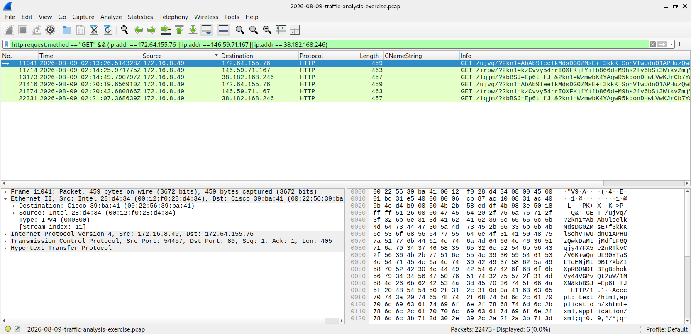
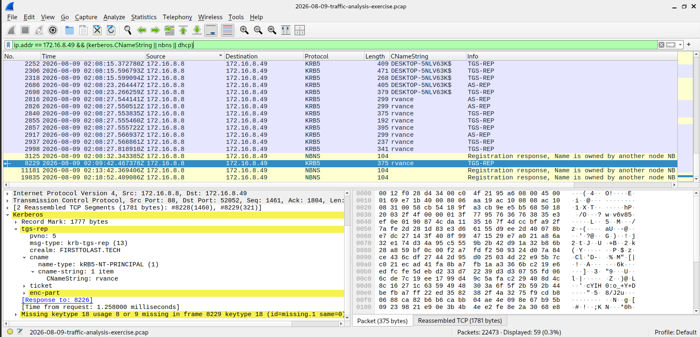
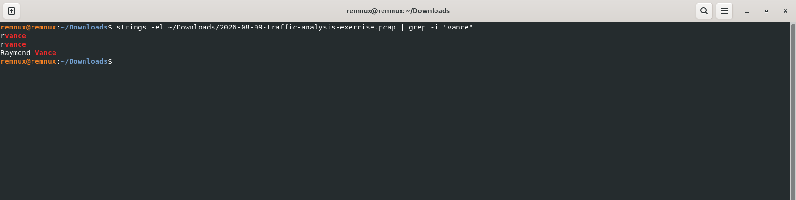
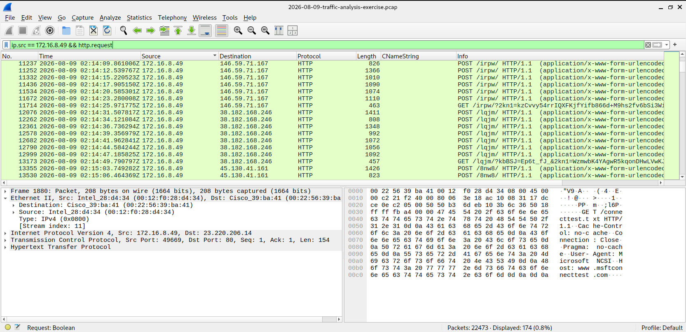
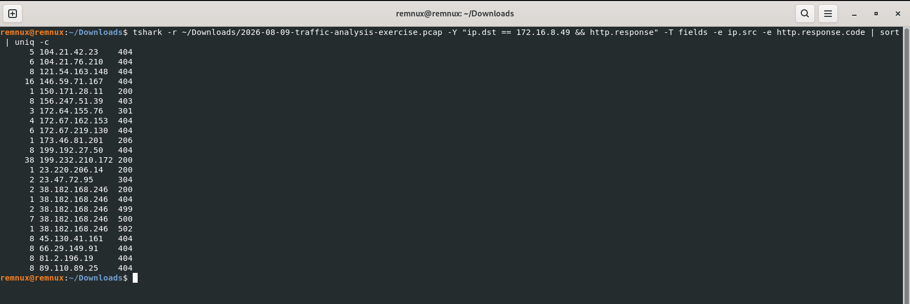

# SOC Incident Investigation: FormBook Info-Stealer C2 & Exfiltration Analysis

## Executive Summary
During a routine SOC shift, multiple Intrusion Detection System (IDS) alerts fired for **`ET MALWARE FormBook CnC Checkin (GET)`** targeting external HTTP endpoints over port 80[cite: 2]. Packet capture analysis (`2026-08-09-traffic-analysis-exercise.pcap`) confirmed an active **FormBook** info-stealer infection on a domain-joined Windows workstation (`DESKTOP-5NLV63K`, `172.16.8.49`) belonging to user **Raymond Vance (`FIRSTTOLAST\rvance`)**[cite: 2, 4, 5, 8].

Further HTTP traffic and response-code analysis revealed classic FormBook decoy-traffic obfuscation: the malware sprayed paired `GET` check-ins and `POST` data exfiltration requests across **15 external domains**[cite: 11, 13]. By filtering out baseline Windows traffic and pivoting on HTTP response codes, the likely active Command & Control (C2) server was isolated to **`38.182.168[.]246` (`www.taibeinan[.]cc`)**[cite: 11, 12, 14]. Subnet scoping confirmed no lateral movement or secondary infections across `172.16.8.0/24`.

---

## Victim Attribution & Environment
| Field | Value |
| :--- | :--- |
| **Infected IP Address** | `172.16.8.49`[cite: 4] |
| **MAC Address** | `00:12:f0:28:d4:34` (`Intel_28:d4:34`)[cite: 4] |
| **Host Name** | `DESKTOP-5NLV63K`[cite: 5] |
| **User Account** | `FIRSTTOLAST\rvance`[cite: 2, 5] |
| **User Full Name** | Raymond Vance[cite: 8] |
| **AD Domain / DC** | `firsttolast.tech` (`172.16.8.8` observed via Kerberos/DNS/LDAP)[cite: 2, 5, 6, 10] |
| **Subnet Scoped** | `172.16.8.0/24` (0 other hosts affected)[cite: 2] |

---

## Investigation Walkthrough

### 1. Alert Triage & Host Identification
Pivoting on the alerted FormBook C2 IPs (`172.64.155.76`, `146.59.71.167`, `38.182.168.246`) in Wireshark immediately isolated `172.16.8.49` (`00:12:f0:28:d4:34`) sending HTTP `GET` check-ins with encoded URI parameters (`/ujvq/?2kn1=...`, `/irpw/?2kn1=...`, `/lqjm/?kb8SJ=...`)[cite: 4].



### 2. Active Directory Attribution
Filtering Kerberos authentication traffic (`ip.addr == 172.16.8.49 && kerberos.CNameString`) revealed the machine account `DESKTOP-5NLV63K$` and user account `rvance` authenticating against the Domain Controller (`172.16.8.8`)[cite: 5]. Because LDAP traffic was encrypted (`SASL GSS-API Privacy`)[cite: 6], UTF-16LE string extraction (`strings -el`) was used on REMnux to recover the user's full name: **Raymond Vance**[cite: 8].




### 3. Active Data Exfiltration (`POST` Traffic)
Expanding the filter to all outbound HTTP requests (`ip.src == 172.16.8.49 && http.request`) uncovered bursts of `POST` requests (`application/x-www-form-urlencoded`, 725–1,429 bytes) starting at `02:13:23 UTC`[cite: 9]. This behavior indicates active exfiltration of stolen host data (credentials, keystrokes, clipboard contents) paired with periodic `GET` check-ins[cite: 9, 13].



### 4. Separating the Active C2 from Decoy Domains
FormBook is known for spraying identical `GET`/`POST` traffic across legitimate and random decoy domains to bury its real C2. Using `tshark` to aggregate HTTP response codes back to `172.16.8.49` separated the signal from the noise[cite: 12, 14]:

* **Baseline Windows Traffic (Excluded):** `edge.microsoft.com` (`150.171.28.11`), `download.windowsupdate.com` (`199.232.210.172`), `www.msftconnecttest.com` (`23.220.206.14`), and `ctldl.windowsupdate.com` (`23.47.72.95`)[cite: 11, 12, 14].
* **14 Decoy Domains:** Returned `404 Not Found`, `403 Forbidden`, or `301 Moved Permanently` (e.g., `www.independent[.]ie`, `www.grinswakebthu[.]info`, `www.legenda-sochi[.]com`), confirming those servers did not recognize the FormBook URI paths[cite: 11, 12, 14].
* **Likely Active C2 (`38.182.168[.]246` — `www.taibeinan[.]cc`):** The **only** FormBook server to return `200 OK` (2x), alongside backend/overload errors (`500` x7, `502` x1, `499` x2, `404` x1)—consistent with an active, heavily loaded C2 panel processing incoming beacons[cite: 11, 12, 14].



---

## Indicators of Compromise (IOCs)

### Primary Suspected C2
* `38.182.168[.]246` — `www.taibeinan[.]cc` (HTTP `200 OK` / `500` / `502` / `499`)[cite: 11, 12, 14]

### FormBook Decoy / Alerted Endpoints
* `104.21.42[.]23` — `www.devinnovationhab[.]team`
* `104.21.76[.]210` — `www.thvwzs[.]com`[cite: 11]
* `121.54.163[.]148` — `www.21207628[.]shop`[cite: 11]
* `146.59.71[.]167` — `www.grinswakebthu[.]info`[cite: 11]
* `156.247.51[.]39` — `www.z61gqw[.]beer`[cite: 11]
* `172.64.155[.]76` — `www.independent[.]ie`[cite: 11]
* `172.67.162[.]153` — `www.titanium303[.]com`[cite: 11]
* `172.67.219[.]130` — `www.www-bet456[.]co`[cite: 11]
* `183.90.186[.]205` — `www.p3x63q[.]garden`[cite: 11]
* `199.192.27[.]50` — `www.kentmediallc[.]com`[cite: 11]
* `45.130.41[.]161` — `www.legenda-sochi[.]com`[cite: 11]
* `66.29.149[.]91` — `www.earthframe[.]site`[cite: 11]
* `81.2.196[.]19` — `www.moxom[.]online`[cite: 11]
* `89.110.89[.]25` — `www.amlgames[.]site`[cite: 11]

---

## MITRE ATT&CK Mapping
* **T1071.001** – Application Layer Protocol: Web Protocols (HTTP `GET`/`POST` C2 & Exfiltration)[cite: 9, 13]
* **T1041** – Exfiltration Over C2 Channel (`application/x-www-form-urlencoded` `POST` bursts)[cite: 9, 13]
* **T1568 / T1001** – Decoy C2 Traffic Obfuscation (15-domain spray)[cite: 11]

---

## Detection Engineering (Splunk SPL)
Hunt for FormBook-style high-volume `POST`/`GET` spraying across multiple unique external domains from a single internal host over port 80:

```spl
index=network sourcetype=stream:http dest_port=80 http_method IN ("GET", "POST")
| where match(uri_path, "^/[a-zA-Z0-9]{4}/$")
| stats dc(site) as unique_domains count(eval(http_method="POST")) as post_count count(eval(http_method="GET")) as get_count values(status) as http_status by src_ip
| where unique_domains >= 5 AND post_count >= 10

```
## Containment & Remediation
1. **Isolate Host:** Network-isolate `DESKTOP-5NLV63K` (`172.16.8.49`) via EDR immediately.
2. **Credential Reset:** Force password reset and revoke active sessions/Kerberos tickets for `FIRSTTOLAST\rvance` (Raymond Vance), plus any browser-saved credentials.
3. **Block IOCs:** Block `38.182.168[.]246` and `www.taibeinan[.]cc` at the perimeter firewall/proxy.
4. **Forensic Triage & Reimage:** Capture volatile memory/disk artifacts to identify the initial delivery vector and persistence mechanism, then reimage the workstation.

## Tools Used
* **Network & Packet Analysis:** Wireshark, `tshark`
* **Forensic Environment:** REMnux (`strings`)
